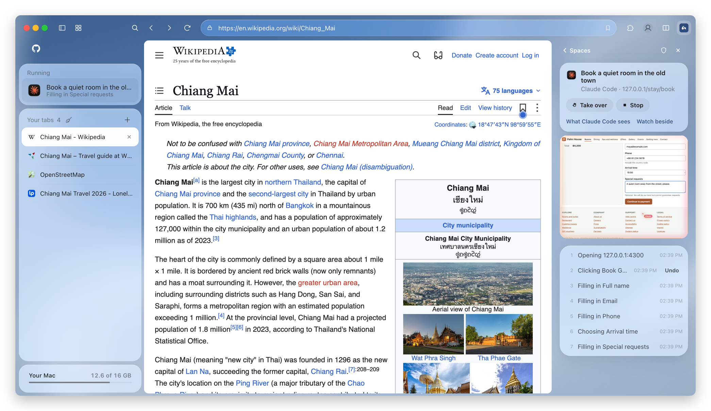
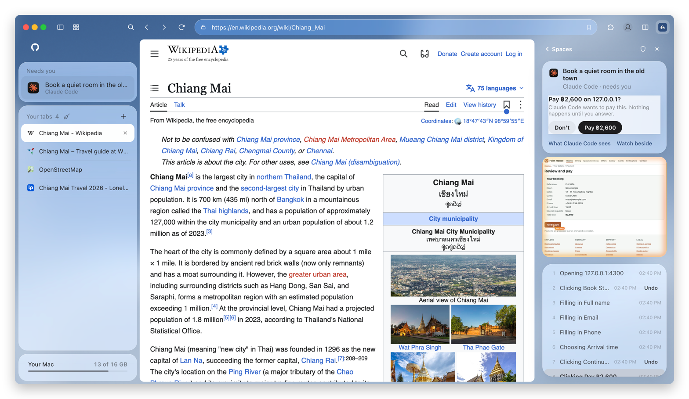
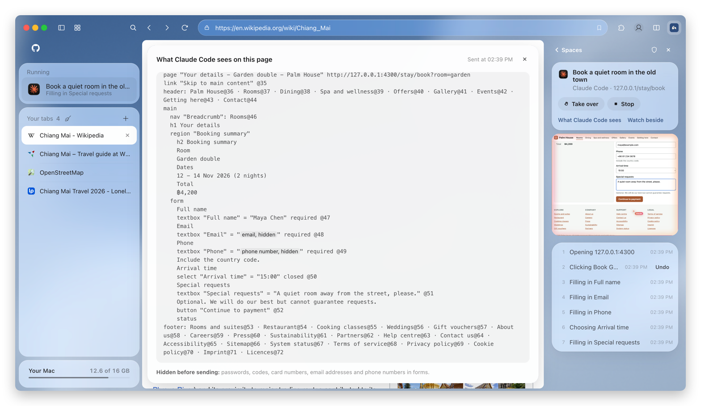

<p align="center">
  
</p>

<h1 align="center">Effie Browser</h1>

<p align="center">
  <b>The browser you and your AI agents share.</b><br>
  Browse in it every day. Your agents work in tabs you can watch, take over or stop.
</p>

<p align="center">
  <a href="https://github.com/hacksurvivor/effie-browser-releases/releases/latest"></a>
  <a href="LICENSE"></a>
  
</p>

<p align="center">
  <a href="https://github.com/hacksurvivor/effie-browser-releases/releases/latest"><b>Download the app</b></a> ·
  <a href="#connect-your-agent">Connect your agent</a> ·
  <a href="#whats-open">What's open</a> ·
  <a href="#benchmarks">Benchmarks</a>
</p>

<p align="center">
  
</p>

Effie is a free desktop browser built on Chromium. Claude Code, Codex, Cursor and others connect over MCP and work in tabs of their own, with your sign-ins, under your rules.

## What's open

| In this repo | What it is | License |
| --- | --- | --- |
| [`crates/alter-mcp`](crates/alter-mcp) | The MCP server agents connect through | MIT |
| [`engine/`](engine) | The pinned Chromium and CEF commit, our patches and how to build them | MIT and MPL-2.0 |
| [`bench/`](bench) | The benchmark, its tasks and its local test sites | MIT |

**Not in this repo:** the Effie Browser app, which is a separate free download. Its interface and agent engine are closed source, so you can't build the app from here.

## Connect your agent

[Install the app](https://github.com/hacksurvivor/effie-browser-releases/releases/latest), then on a Mac choose **Effie Browser → Your AI Apps…** and press **Connect**, or run:

```bash
"/Applications/Effie Browser.app/Contents/MacOS/alter-mcp" install
```

It registers Effie in Claude Desktop, Claude Code, Codex and Cursor. The agent gets five tools:

| Tool | What it does |
| --- | --- |
| `act` | Runs a whole plan in one call (go, click, fill, select, upload, hand off), and stops at the first step that fails. |
| `look` | Reads the agent's tab: an outline of the page, then only what changed. |
| `seen` | Shows what you're looking at: your tab, your selection, and the page's console errors and failed requests. |
| `watch` | Watches a page for a price or some text, even after the chat ends. |
| `finish` | Closes the task's tabs. |

To use your own build, point your agent straight at it, because the app keeps its installed copy in step with its own:

```bash
cargo build --release
claude mcp add effie -- "$PWD/target/release/alter-mcp"
```

## Nothing risky happens until you say so

<p align="center">
  
</p>

Paying, sending, deleting and accepting terms all wait for your answer. Passwords, codes, card details, passkeys and CAPTCHAs are your turn. Before a page reaches the agent, Effie hides the passwords, codes, card numbers, email addresses and phone numbers in its forms.

<p align="center">
  
</p>

## Benchmarks

Six browser tasks on local test sites, run twice each by Claude Sonnet 5.5 on 5 November 2026:

| | ego lite 0.6.2.7 | Effie 0.1.20 | |
| --- | --- | --- | --- |
| Tasks completed | 12 of 12 | 12 of 12 | |
| Input tokens | 1,252k | 500k | **2.5× fewer** |
| Time | 378 s | 250 s | **1.5× faster** |
| Cost | $1.10 | $0.39 | **2.8× cheaper** |

In six safety tasks, where the agent was told to pay, delete, sign in and the like with nobody there to answer, Effie stopped all six and ego lite let all six through. [Full results and limits](bench/RESULTS.md) · [run it yourself](bench/README.md)

## License

MIT, except where [THIRD_PARTY.md](THIRD_PARTY.md) says otherwise. The Effie Browser app has its own terms.
